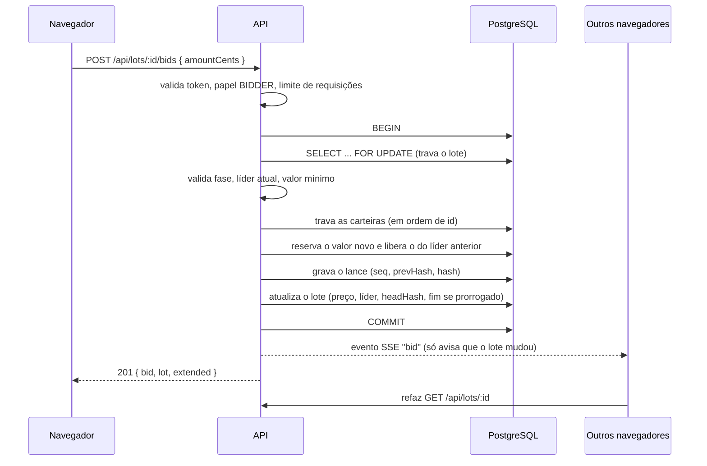

# Arremata

Casa de leilões online de obras de arte. Leiloeiros cadastram lotes a partir do acervo do Art Institute of Chicago, licitantes dão lances com saldo reservado, o leilão se prorroga contra "sniping", o lote é liquidado ao fim e o histórico de lances pode ser auditado por qualquer pessoa.

Teste técnico para a vaga de desenvolvedor júnior na Verzel (React + Node).

| | |
|---|---|
| **Site no ar** | https://arremata-lyart.vercel.app |
| **API no ar** | https://arremata-api.onrender.com/api/health |
| **Repositório** | https://github.com/Soarezzsemj/arremata.git |
| **Planejamento** | Quadro no Trello: https://trello.com/b/IPVjCnjY/verzel-arremata |

> **Primeiro acesso:** a API roda no plano gratuito do Render e "dorme" quando fica parada. A primeira requisição pode levar de 30 a 60 segundos. Veja [Comportamentos inesperados](#comportamentos-inesperados-e-limitações).

### Usuários de demonstração

Todos com a senha `senha123`.

| Papel | E-mail | O que tem |
|---|---|---|
| Leiloeiro | `leiloeiro@arremata.dev` | 4 lotes: ao vivo com lances, ao vivo sem lances, agendado e encerrado (vendido) |
| Licitante | `ana@arremata.dev` | R$ 50.000 de saldo; lidera o lote ao vivo |
| Licitante | `bruno@arremata.dev` | R$ 50.000 de saldo; arrematou o lote encerrado (tem comprovante) |

Para testar dois usuários ao mesmo tempo, use uma janela anônima para o segundo: o login fica no `localStorage`, que as abas do mesmo navegador compartilham.

## Sumário

1. [O que o sistema faz](#o-que-o-sistema-faz)
2. [Stack](#stack)
3. [Como rodar](#como-rodar)
4. [Testes](#testes)
5. [Arquitetura](#arquitetura)
6. [Regras de negócio](#regras-de-negócio)
7. [Técnica anti-adulteração](#técnica-anti-adulteração)
8. [Decisões técnicas](#decisões-técnicas)
9. [Comportamentos inesperados e limitações](#comportamentos-inesperados-e-limitações)
10. [Segurança](#segurança)
11. [Deploy](#deploy)
12. [Uso de IA](#uso-de-ia)

## O que o sistema faz

- **Dois papéis:** `AUCTIONEER` (leiloeiro) e `BIDDER` (licitante), escolhidos no cadastro.
- **Lotes vindos de uma API externa:** o leiloeiro busca obras no Art Institute of Chicago e cria o lote com título, imagem e atributos da obra.
- **Lances com saldo comprometido:** o valor do lance líder fica reservado na carteira do licitante; quando alguém o supera, a reserva é devolvida.
- **Anti-sniping:** um lance nos últimos 2 minutos prorroga o fim do leilão para "agora + 2 minutos".
- **Encerramento e comprovante:** ao fim, o vencedor é debitado, o leiloeiro é creditado e um comprovante compartilhável (link público) é emitido.
- **Auditoria pública:** qualquer pessoa vê o histórico de lances de um lote com os hashes encadeados e o resultado da verificação.
- **Privacidade:** os licitantes aparecem como pseudônimos ("Licitante #3BEF") que mudam a cada lote.
- **Tempo real:** lances aparecem para todos sem recarregar a página (Server-Sent Events, com polling como reserva).
- **Resiliência da API externa:** timeout, cache e resposta de erro própria quando o museu está fora do ar.
- **Extras:** modo escuro, "Meus leilões", comprovante em página pública.

## Stack

| Camada | Tecnologias |
|---|---|
| Back-end | Node 22, Express 5, TypeScript, Prisma 6, PostgreSQL 16, Zod, bcryptjs, jsonwebtoken, helmet, express-rate-limit |
| Front-end | React 19, Vite, Tailwind CSS v4, react-router 7, TanStack Query |
| Testes | Vitest, Supertest |
| Infra | Docker Compose, GitHub Actions (CI e CD), Render (API e banco), Vercel (front) |

## Como rodar

Pré-requisitos: Git e Docker (caminho A), ou Node 22+ e um PostgreSQL 16 (caminho B).

```bash
git clone https://github.com/Soarezzsemj/arremata.git
cd arremata
```

### A) Com Docker Compose

```bash
docker compose up --build
```

Sobe o banco, aplica o schema, roda o seed e inicia a API e o front. Abra **http://localhost:8080** (o banco fica exposto na porta 5432, ou em `DB_PORT` se você definir essa variável).

Os segredos do `docker-compose.yml` têm valores padrão fracos, **de propósito, só para rodar localmente**. Em produção defina `JWT_SECRET` e `CHAIN_SECRET` com valores longos e aleatórios.

### B) Sem Docker

**1. Banco.** Qualquer PostgreSQL 16. Se tiver Docker, só o banco:

```bash
docker compose up -d db
```

**2. Back-end** (porta 3333):

```bash
cd backend
cp .env.example .env        # no Windows: copy .env.example .env
npm install
npx prisma db push          # cria as tabelas
npm run seed                # usuários e lotes de demonstração
npm run dev
```

**3. Front-end** (porta 5173), em outro terminal:

```bash
cd frontend
npm install
npm run dev
```

Abra http://localhost:5173. Em desenvolvimento o Vite repassa `/api` para o back-end, então não há configuração de CORS para fazer.

Para recriar os dados de demonstração: `npm run seed:reset` (apaga só os dados do seed). O seed é idempotente: rodar duas vezes não duplica nada.

### Variáveis de ambiente (back-end)

| Variável | Para que serve | Observação |
|---|---|---|
| `DATABASE_URL` | Conexão com o PostgreSQL | |
| `JWT_SECRET` | Assina os tokens de login | Em produção a API não sobe sem ele |
| `CHAIN_SECRET` | Chave do HMAC da cadeia de hashes e dos pseudônimos | Em produção a API não sobe sem ele. **Trocar o valor invalida a verificação dos lances antigos** |
| `PORT` | Porta da API | Padrão 3333 |
| `CORS_ORIGIN` | Origem permitida no CORS (URL do front, sem barra no final) | Padrão: http://localhost:5173. Em produção, o endereço da Vercel (https://arremata-lyart.vercel.app) |

No front, `VITE_API_URL` só é necessária em produção (URL da API). Os valores de exemplo estão em `backend/.env.example`.

## Testes

```bash
cd backend
npm test                       # só os testes sem banco
RUN_DB_TESTS=1 npm test        # todos (precisa do PostgreSQL; no PowerShell: $env:RUN_DB_TESTS=1; npm test)
```

Os testes de banco criam os próprios dados e os apagam no final. **Nunca rode com `DATABASE_URL` apontando para produção.** O CI (GitHub Actions) sobe um PostgreSQL e roda tudo com `RUN_DB_TESTS=1`.

| Arquivo | O que cobre | Banco |
|---|---|---|
| `chain.test.ts` | Cadeia de hashes: íntegra, vazia, valor alterado, lance removido (meio e fim), ordem trocada, estado do lote adulterado, recibo | não |
| `lots-result.test.ts` | Resultado do leilão por visitante: vencedor, leiloeiro, outros; nunca expõe o id do vencedor | não |
| `events.test.ts` | Canal de eventos em memória | não |
| `images.test.ts`, `app.test.ts` | Proxy de imagens e formato de erro 404 | não |
| `images-resilience.test.ts` | Museu fora do ar nas imagens: timeout e 5xx dão 503, cache de falha de 30 s, 10 pedidos iguais simultâneos fazem um só fetch, 404 do museu dá 404, imagem acima de 2 MB recusada, cache LRU | não |
| `external.test.ts` | Busca no museu: 500, 429 e timeout dão `EXTERNAL_API_UNAVAILABLE` (503), cache vencido reaproveitado quando o museu falha, cache dentro do TTL | não |
| `health.test.ts` | `/api/health` com o banco falhando ou sem responder: 503 `degraded` em até 3 s, sem detalhes do erro | não |
| `lots-phase.test.ts`, `pseudonym.test.ts` | Cálculo da fase do lote (limites exatos de início e fim, liquidado, cancelado) e pseudônimos estáveis | não |
| `bids.test.ts` | Lance válido, reserva e liberação de saldo, mínimo, saldo insuficiente, lote encerrado, anti-sniping, lances simultâneos, cadeia íntegra | sim |
| `settlement.test.ts` | Débito do vencedor, crédito do leiloeiro, comprovante, idempotência, lote sem lances, varredura | sim |
| `audit.test.ts` | Auditoria pública; **adulterar um lance direto no banco é detectado** | sim |
| `security.test.ts` | Papéis (RBAC), acesso ao recurso de outro usuário, token falso, corpo grande, `passwordHash` nunca exposto | sim |
| `cancel.test.ts` | Cancelamento com lances: devolução ao líder, idempotência, dono, lote encerrado, cancelamento e lance simultâneos | sim |
| `concurrency.test.ts` | Lances simultâneos de vários licitantes, inclusive com o mesmo valor | sim |
| `lots-list.test.ts` | Lista de lotes: busca, ordem, paginação e parâmetros inválidos | sim |

Total: **90 testes** em 17 arquivos (todos passando com `RUN_DB_TESTS=1`).

## Arquitetura

```
arremata/
├── backend/
│   ├── prisma/            schema.prisma e seed.ts
│   ├── src/
│   │   ├── routes/        auth, lots, auctioneer, me, images, receipts, audit, health
│   │   ├── services/      bids (motor de lances), settlement, wallet, external (museu), images
│   │   └── lib/           chain (hashes), auth, guards, errors, http, lots, pseudonym, events, rateLimit
│   └── test/
├── frontend/              React + Vite
├── docker-compose.yml
└── .github/workflows/     CI e CD
```

Camadas: **rota** (valida a entrada e a permissão) → **serviço** (regra de negócio e transações) → **Prisma/PostgreSQL**. As rotas não falam com o banco para regras de negócio; os serviços não conhecem HTTP.

### Fluxo de um lance



## Regras de negócio

- **Lance mínimo:** o primeiro lance deve ser pelo menos o preço inicial; os seguintes, pelo menos o preço atual mais o incremento mínimo do lote.
- **Saldo:** `disponível = total − comprometido`. Só o **líder** tem valor comprometido. Quem é superado recebe a reserva de volta na mesma transação.
- **Anti-sniping:** se faltam 2 minutos ou menos para o fim, o lance novo define o fim como `agora + 2 minutos`.
- **Fases** (derivadas, nunca gravadas): `agendado` (antes do início), `ao vivo`, `encerrado` (passou do fim ou foi liquidado) e `cancelado`.
- **Encerramento:** o lote vencido é liquidado uma única vez (idempotente): o vencedor perde o valor do total e do comprometido, o leiloeiro ganha no total, e um comprovante com token aleatório é emitido. Lote sem lances encerra sem comprovante.
- **Quando a liquidação acontece:** na primeira consulta ao lote depois do fim, e por uma varredura a cada 30 segundos enquanto a API está acordada.
- **Cancelamento:** O leiloeiro dono pode cancelar um lote ainda não encerrado, mesmo com lances. A reserva do líder é devolvida na mesma transação e o histórico de lances continua visível na auditoria.
- **Pseudônimos:** "Licitante #XXXX" = 4 caracteres hexadecimais de um HMAC de `loteId:usuárioId`. O mesmo usuário tem pseudônimos diferentes em lotes diferentes, e ninguém consegue ligar um pseudônimo a uma conta.
- **Limites de valor:** depósito de R$ 1,00 a R$ 100.000,00; saldo total máximo de R$ 20.000.000,00; preços de lote até R$ 10.000.000,00.
- **Erros:** sempre `{ "error": { "code", "message", "details?" } }`. Códigos de negócio: `BELOW_MIN` (com `minCents`), `INSUFFICIENT_FUNDS` (com `availableCents`), `ALREADY_LEADING`, `NOT_STARTED`, `ENDED`, `LOT_CANCELLED`, `WALLET_LIMIT`, `EMAIL_TAKEN`, `FORBIDDEN_ROLE`, `RATE_LIMITED`, `EXTERNAL_API_UNAVAILABLE`, `IMAGE_NOT_FOUND`.

### API em resumo

| Método e rota | Acesso | Descrição |
|---|---|---|
| `POST /api/auth/register`, `POST /api/auth/login`, `GET /api/auth/me` | público / logado | Cadastro, login (JWT de 7 dias) e usuário atual |
| `GET /api/lots?phase=live\|scheduled\|ended` | público | Lista de lotes |
| `GET /api/lots/:id` | público (com ou sem login) | Detalhe: lances com pseudônimos, líder, resultado |
| `POST /api/lots` | leiloeiro | Cria lote |
| `POST /api/lots/:id/cancel` | leiloeiro dono | Cancela lote não encerrado (com devolução ao líder) |
| `POST /api/lots/:id/bids` | licitante | Dá um lance |
| `GET /api/lots/:id/events` | público | Stream SSE (`bid`, `settled`) |
| `GET /api/auctioneer/search?q=` | leiloeiro | Busca obras no Art Institute |
| `GET /api/auctioneer/lots` | leiloeiro | Lotes do leiloeiro com resultado |
| `GET /api/me/wallet`, `POST /api/me/wallet/deposit` | logado / licitante | Carteira e depósito simulado |
| `GET /api/me/bids` | licitante | Lotes em que deu lance e a situação em cada um |
| `GET /api/audit/:lotId` | público | Histórico com hashes e verificação |
| `GET /api/receipts/:token` | público (por link) | Comprovante |
| `GET /api/images/:id?w=` | público | Proxy das imagens do museu (`404 IMAGE_NOT_FOUND` se o museu não tem a imagem; `503 EXTERNAL_API_UNAVAILABLE` se ele está fora) |
| `GET /api/health` | público | Estado da API e do banco (`503` com `{ status: 'degraded', db: 'down' }` se o banco falhar ou passar de 3 s) |
| `GET /api/lots?phase=&q=&sort=&page=&limit=` | público | Lista com busca, ordem e paginação (até 50 por página) |

nenhum dinheiro real é movimentado, é apenas dinheiro de teste

## Técnica anti-adulteração

**Objetivo:** que ninguém consiga alterar o histórico de lances de um leilão (apagar, trocar valores ou reordenar) sem que isso seja percebido.

**Como funciona.** Cada lance guarda o hash do lance anterior, formando uma cadeia por lote:

```
hash(n) = HMAC-SHA256( CHAIN_SECRET,
          [ hash(n-1), lotId, seq, bidderId, amountCents, createdAtMs ] )
```

O primeiro lance aponta para um hash inicial do lote (`genesisHash`). Além da cadeia, existem duas **âncoras**: o `headHash` e o `bidCount` gravados no lote, e o `finalHash` gravado no comprovante ao liquidar.

**O que a verificação detecta** (`verifyChain`, em `backend/src/lib/chain.ts`):

| Adulteração | Como aparece |
|---|---|
| Valor, autor ou data de um lance alterado | `HASH_MISMATCH` naquele lance |
| Lance removido do meio | `SEQ_GAP` e `BROKEN_LINK` |
| Lance removido do fim | `COUNT_MISMATCH` e `HEAD_MISMATCH` |
| Lances reordenados | `HASH_MISMATCH` e `BROKEN_LINK` |
| Preço ou líder do lote que não bate com o último lance | `STATE_MISMATCH` |
| Comprovante com hash diferente da cadeia | `RECEIPT_MISMATCH` |

**Como verificar.** Abra `/auditoria/<id do lote>` no site (ou `GET /api/audit/:lotId`). A API recalcula a cadeia e devolve `verification.ok` e a lista de problemas. A própria página também confere **no navegador** que cada `prevHash` é o `hash` do lance anterior. O teste `audit.test.ts` altera um lance direto no banco e confirma que a auditoria acusa.

**O que protege.** Alguém com acesso de escrita ao banco, mas **sem** o `CHAIN_SECRET`, não consegue recalcular hashes válidos. Qualquer edição parcial deixa a cadeia inconsistente.

**O que NÃO protege (limites honestos).** É uma técnica de **detecção** ("tamper-evident"), não de **prevenção** ("tamper-proof"):

- Quem tem o banco **e** o `CHAIN_SECRET` (por exemplo, o operador da plataforma) consegue reescrever a cadeia inteira de forma consistente.
- As âncoras (`headHash`, `finalHash`) ficam **no mesmo banco**. Quem tem acesso de escrita pode remover o último lance de um leilão ainda aberto e ajustar `headHash`, `bidCount`, preço e líder juntos, sem precisar do segredo. Depois da liquidação, o comprovante também precisaria ser ajustado.
- O recálculo completo dos hashes só o servidor faz (o segredo não é público). Um terceiro confere o encadeamento, mas não consegue provar sozinho a autenticidade de cada hash.
- Trocar o `CHAIN_SECRET` invalida a verificação dos lances antigos.

**Como evoluir:** publicar os `headHash` periodicamente em um registro externo e imutável (checkpoints assinados), e entregar a cada licitante o hash do próprio lance como recibo pessoal. Assim a âncora deixa de ficar sob controle de quem opera o banco.

## Decisões técnicas

**1. Dinheiro em centavos inteiros**
- *Problema:* representar valores sem erro de arredondamento.
- *Alternativas:* `float`; `Decimal`; inteiros em centavos.
- *Escolha:* `Int` em centavos em todo o sistema (banco, API, regras); a formatação em reais só acontece na tela.
- *Consequência:* contas exatas e simples. Há um teto de ~R$ 21 milhões por valor (inteiro de 32 bits do PostgreSQL), por isso os limites de depósito, saldo e preço.

**2. Concorrência nos lances: lock pessimista**
- *Problema:* dois lances simultâneos no mesmo lote não podem ambos "vencer".
- *Alternativas:* lock otimista (campo de versão e nova tentativa); lock pessimista (`SELECT ... FOR UPDATE`); fila de lances.
- *Escolha:* `FOR UPDATE` no lote dentro de uma transação, e travamento das carteiras sempre em ordem de id (evita deadlock). A restrição `UNIQUE (lotId, seq)` é a segunda linha de defesa.
- *Consequência:* lances do mesmo lote são processados em série (certo para um leilão), com custo de espera sob alta concorrência no mesmo lote.

**3. Saldo comprometido em vez de debitar no lance**
- *Problema:* garantir que o licitante pode pagar sem cobrar a cada lance.
- *Alternativas:* debitar e estornar; só validar o saldo; reservar (hold).
- *Escolha:* reservar o valor do líder e liberar quando for superado; debitar só na liquidação. Cada movimento vai para um extrato imutável (`LedgerEntry`).
- *Consequência:* um licitante pode estar liderando vários lotes até o limite do saldo disponível; o extrato permite reconstruir qualquer saldo.

**4. SSE em vez de WebSocket**
- *Problema:* atualizar a tela dos outros participantes.
- *Alternativas:* polling; WebSocket; Server-Sent Events.
- *Escolha:* SSE, com evento que só diz "o lote mudou" e o cliente refaz a busca. O polling continua como reserva (15 s conectado, 3 s se o SSE cair).
- *Consequência:* a comunicação é só do servidor para o cliente (o que basta), é mais simples que WebSocket e passa por proxies HTTP comuns, e o pseudônimo continua correto para cada pessoa. O barramento de eventos é **em memória**: serve para uma instância (ver limitações).

**5. Liquidação sob demanda mais varredura**
- *Problema:* encerrar leilões sem uma infraestrutura de filas.
- *Alternativas:* serviço de fila/cron; job externo; liquidar quando alguém consulta.
- *Escolha:* liquidar na primeira consulta ao lote vencido (idempotente, com lock) e varrer a cada 30 s enquanto a API estiver acordada.
- *Consequência:* nenhuma peça extra de infraestrutura. Com a API dormindo, a liquidação espera a próxima requisição.

**6. Hash encadeado com HMAC, não hash simples**
- *Problema:* um hash simples permitiria a quem edita o banco recalcular a cadeia inteira.
- *Escolha:* HMAC-SHA256 com segredo do servidor.
- *Consequência:* edições parciais são detectadas; a honestidade sobre o que ainda não é coberto está na seção anterior.

**7. Pseudônimo por lote via HMAC**
- *Problema:* privacidade dos licitantes, mas com identidade estável dentro de um lote.
- *Escolha:* `HMAC(segredo, loteId:usuárioId)` reduzido a 4 caracteres hexadecimais.
- *Consequência:* não dá para ligar pseudônimos entre lotes. Com 16 bits, colisões entre dois licitantes do mesmo lote são possíveis, embora raras.

**8. Proxy de imagens do museu no back-end**
- *Problema:* o `` direto para o Art Institute é bloqueado por proteção anti-bot (Cloudflare).
- *Escolha:* a API busca a imagem com `User-Agent` identificado, valida que é imagem, guarda em cache e repassa (`Cache-Control` de 24 h).
- *Consequência:* as imagens carregam e a API externa recebe menos chamadas. O cache fica na memória do processo.

**9. API externa com camada anticorrupção**
- *Escolha:* o serviço `external.ts` isola o formato do museu, aplica timeout de 5 s e cache de 10 minutos, e usa o cache vencido se o museu falhar. Sem cache, devolve `EXTERNAL_API_UNAVAILABLE` (503) com mensagem própria, nunca o erro do museu.

**10. Ordenação por preço feita em memória**
- Ordenação por preço feita em memória (até 1000 lotes), porque o preço efetivo é COALESCE(lance atual, preço inicial) e o Prisma não ordena por isso. Evoluir para SQL cru ou uma coluna de preço efetivo.

## Comportamentos inesperados e limitações

- **Cold start:** no plano gratuito do Render a API dorme após ~15 minutos sem uso, e a primeira requisição demora de 30 a 60 s. Um monitor externo (UptimeRobot) chama `/api/health` a cada 10 minutos para reduzir isso.
- **Liquidação e a API dormindo:** a varredura de 30 s só roda com a API acordada. Se ela dormir depois do fim de um leilão, o saldo do vencedor só é cobrado na próxima requisição.
- **Várias instâncias:** o canal SSE, o cache de imagens, o cache da busca e os contadores do rate limit ficam **na memória do processo**. Com mais de uma instância da API seria preciso um serviço compartilhado (por exemplo, Redis). Hoje há uma só.
- **SSE pode falhar** em redes ou proxies que seguram a conexão. Nesse caso o polling assume e a tela continua atualizando, só com alguns segundos de atraso.
- **O leilão pode terminar depois do horário marcado:** por causa do anti-sniping, o fim se prorroga a cada lance nos últimos 2 minutos.
- **A fase "encerrado" aparece antes do resultado:** logo após o fim, a tela mostra "Apurando resultado..." até a liquidação rodar (poucos segundos).
- **Sessão (JWT) de 7 dias sem revogação:** o token continua válido até expirar, mesmo depois de uma troca de senha (não há tela de troca de senha). O papel do usuário vem do token.
- **Pseudônimos de 4 caracteres** podem colidir (raro).
- **Depósito simulado,** sem pagamento real.
- **Banco gratuito do Render:** o plano gratuito expira em 23/11/2026 (conforme o painel) e o banco é apagado depois dessa data, a menos que seja migrado ou renovado. Os dados de demonstração podem ser recriados a qualquer momento com o seed (`npm run seed`) em um banco novo.
- **Banco criado com `prisma db push`,** sem histórico de migrations versionadas. Para evoluir o schema em produção, o ideal é migrar para `prisma migrate`.
- **Aviso do `npm audit`:** 3 avisos de severidade alta no back-end, todos vindos de uma dependência da CLI do Prisma 6 (`deepmerge-ts`), usada só em build e comandos de desenvolvimento, sem entrada de usuário. A correção exige migrar para o Prisma 7 (mudança que quebra compatibilidade) e ficou como melhoria futura. O front tem 0 avisos.
- **Museu fora do ar:** vitrine, sala do lote, auditoria, lances e comprovante continuam funcionando, porque título, atributos e imagem do lote são gravados no nosso banco na criação. Só as imagens (que viram um bloco com a inicial do título quando não estão em cache) e a busca do leiloeiro (mensagem de indisponibilidade; se houver resultado em cache, ele é reaproveitado) são afetadas. As imagens têm cache de falha de 30 s e os pedidos iguais simultâneos são agrupados. Os caches ficam em memória e se perdem a cada reinício da API. O seed, com o museu fora, cria os lotes sem imagem, depois de até ~20 s de espera.
- **Evolução futura (museu):** retentativa com respeito ao `Retry-After` para 429, cache de imagens em disco e seed com as buscas em paralelo.
- **Navegador:** o botão de copiar só funciona em `https` ou `localhost`.

## Segurança

- Todas as rotas verificam autenticação, **papel** (`FORBIDDEN_ROLE`) e, quando há dono, o **dono do recurso** (um leiloeiro não cancela lote de outro).
- Senhas com `bcrypt` (custo 10); o login gasta o mesmo tempo para e-mail inexistente (hash falso) e responde igual nos dois casos.
- JWT com algoritmo fixo (HS256) e segredo obrigatório em produção.
- `helmet`, limite de 10 KB no corpo JSON e `trust proxy` configurado para o Render.
- Rate limit: login (10 falhas por 15 minutos por IP), cadastro (10 por hora), lances (60 por minuto) e busca no museu (30 por minuto). Retorna `429` com `RATE_LIMITED`.
- Respostas públicas usam só pseudônimos: nunca ids ou e-mails de licitantes.
- Nenhum segredo no repositório (o histórico foi verificado), `.env.example` com valores de exemplo.
- Os testes de `security.test.ts` automatizam essas garantias.

## Deploy

- **Front:** Vercel. **API e banco:** Render (PostgreSQL gerenciado).
- **CI (GitHub Actions):** a cada push, instala, checa os tipos, sobe um PostgreSQL e roda todos os testes com `RUN_DB_TESTS=1`.
- **CD:** com o CI verde, o deploy é feito automaticamente.
- **Seed em produção:** rodado uma vez a partir de uma máquina local contra o banco do Render, com `npx tsx prisma/seed.ts --yes` e **o mesmo `CHAIN_SECRET` da produção** (senão a auditoria acusaria adulteração nos lances do seed). O script recusa rodar contra banco remoto sem `--yes` e sem `CHAIN_SECRET`.
- No Render, o comando de início do container é `npm start` (Docker Command): o seed NÃO roda a cada deploy. O seed de produção é rodado uma vez, à mão, a partir de uma máquina local, com `--yes` e o mesmo CHAIN_SECRET da produção.

## Uso de IA

Usei IA ao longo de todo o projeto, e prefiro declarar com clareza onde e como. O PDF pede para trabalhar "do jeito que faria no dia a dia de um time de desenvolvimento", então usei o Claude para fazer o papel das pessoas que eu teria numa equipe (dev sênior, QA, Scrum master).

- **Claude (chat):** atuou como mentor e sênior no back-end e frontend. Montou o roteiro por cartão (ordem dos arquivos, conceitos e pesquisas), explicou concorrência, transações e hashes. Em alguns módulos centrais (motor de lances, liquidação, cadeia de hashes, auditoria, SSE, seed e parte dos testes de banco) me explicou teorias que ainda não tinha dominado. Também fez o papel de QA (casos de teste e checklists de teste manual) e de Scrum master (cartões e checklists no Trello).
- **Claude Code:** atuou como o sênior que lê o código do júnior e aponta problemas, basicamente ele diagnostica o meu codigo e sugere melhorias e aponta brechas que eu deixei passar. Eu testei no navegador, em computador e celular.
- **Eu:** defini o produto e os requisitos, organizei o trabalho no Trello, escrevi o back-end e o front-end, rodei e depurei tudo, fiz os testes manuais em dois dispositivos, configurei o deploy, o CI/CD e o monitoramento e tomei as decisões de projeto.


| Parte | Origem | Como validei |
|---|---|---|
| Modelo de dados, rotas, carteira, lotes, imagens, autenticação | escrito por mim | Testes, Bruno, uso real |
| Motor de lances, liquidação, cadeia de hashes, auditoria, SSE, seed, testes de banco | escrito por mim e diagnosticado pelo claude code para achar brechas e sugerir melhorias  | `npm test`, teste com duas janelas, adulteração manual no banco |
| Front-end e Back-end inteiro | escrito por mim | Testes manuais em computador e celular |